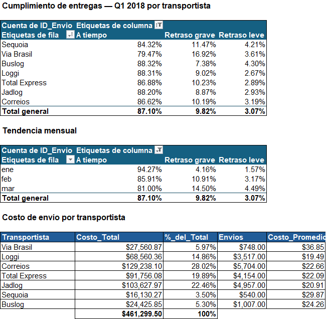

# Mini-Proyecto 01: Auditoría de Logística y SLA de Envíos

## 📌 Descripción del Caso de Negocio
Operaciones necesita medir el cumplimiento de la promesa de entrega del primer
trimestre de 2018, identificar qué transportista incumple y cuánto cuesta ese
incumplimiento frente al SLA comprometido.

## 🛠️ Entorno y Tecnologías
* **Herramienta:** Microsoft Excel (tablas estructuradas, fórmulas y tablas dinámicas)
* **Datos:** 20.627 envíos reales de e-commerce (Q1 2018)

## 📂 Estructura de Archivos
* **`data/raw/`**: envíos originales y maestro de transportistas.
* **`workbook/auditoria_sla_q1_2018.xlsx`**: limpieza, clasificación, pivotes y análisis de costo.
* **`reports/cumplimiento_sla.png`**: vista del tablero final (cumplimiento por transportista y costo por envío).

## 📊 Hallazgos
1. **87,1 % de los envíos cumplió la promesa al cliente**, pero solo **21,0 % cumplió el
   SLA interno** del transportista. La fecha prometida al comprador está inflada: el
   cliente casi no se queja mientras la operación incumple su propio estándar.
2. **El retraso es severo cuando ocurre:** 1.955 envíos con más de 3 días de retraso
   contra 612 leves. El peor caso llegó a 188 días.
3. **Via Brasil es la más cara y la que peor cumple:** 36,85 por envío frente a 22,36
   de media, con 79,5 % de cumplimiento. Opera solo Norte y Nordeste, así que el
   sobrecosto es regional, no de la transportista.
4. **Tendencia mensual en deterioro:** 94,3 % en enero, 85,9 % en febrero, 81,0 % en
   marzo. Puede estar exagerada por envíos de marzo aún sin cerrar.

## 💡 Conceptos Técnicos Aplicados
* **Limpieza de dimensión:** `ESPACIOS` y `NOMPROPIO` para normalizar 35 variantes
  de texto en 7 transportistas.
* **Manejo defensivo de tipos:** `ESNUMERO` + `SI.ERROR` para separar fechas reales
  de los 721 envíos pendientes sin contaminar los promedios.
* **Fechas operativas:** resta directa (días calendario) frente a `DIAS.LAB`
  (días hábiles): 15,68 vs 12,07 de tránsito medio.
* **Clasificación:** `SI.CONJUNTO` ordenado de la condición más estricta a la más
  general, con comodín final.
* **Cruce de tablas:** `BUSCARX` contra el maestro de transportistas, sin depender
  de la posición de las columnas.
* **Resumen:** tabla dinámica con `% del total de fila` y `SUMAR.SI.CONJUNTO` para
  el costo por transportista.

## ⚠️ Limitaciones
* La transportista es una asignación por región: el dataset original no publica
  la transportista real. El análisis por transportista está confundido con la
  geografía.
* Los días de SLA del maestro se definieron para el ejercicio.