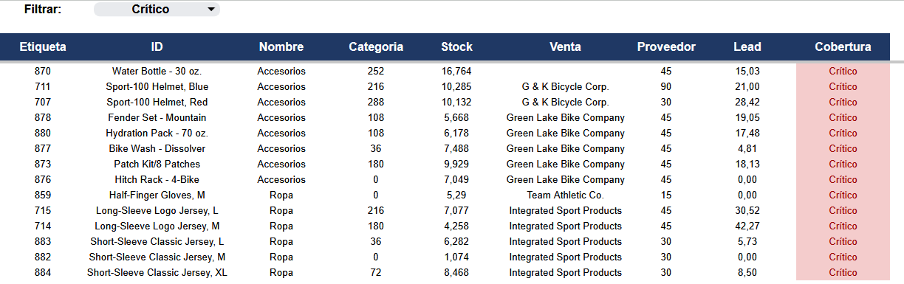

# Mini-Proyecto 02 — Control de stock y quiebres

**Herramienta:** Google Sheets  
**Datos:** 265 SKUs y 86 proveedores (AdventureWorks)  
**Objetivo:** identificar quiebres y exceso de stock para priorizar la reposición.

## Caso de negocio

Una distribuidora de bicicletas y accesorios necesita saber qué SKUs están en riesgo de quiebre y cuáles tienen exceso de inventario. Con el stock actual y la venta promedio diaria, Operaciones necesita una lista priorizada de productos para reponer.

La pregunta que responde el análisis es:

> ¿Qué SKUs no alcanzan a cubrir su lead time con el stock actual y, por lo tanto, deben reponerse primero?

## Datos

- `inventario_skus.csv`: 265 SKUs con stock, venta promedio diaria, proveedor, lead time y punto de reorden.
- `proveedores.csv`: 86 proveedores con país, lead time promedio y pedido mínimo.
- 69 SKUs vendieron en el último año.
- 196 SKUs no vendieron en el último año: stock muerto.
- 4 categorías después de la limpieza: Accesorios, Componentes, Insumos y Ropa.



## Flujo del análisis

1. **RAW:** carga de los dos CSV sin modificar.
2. **Staging:** normalización de categorías, detección de nombres repetidos y stock nulo, y cruce con proveedores.
3. **Modelado:** cálculo de cobertura en días y clasificación de riesgo.
4. **Presentación:** lista desplegable de riesgos y vista filtrada de SKUs.

## Hallazgos

1. **14 de los 69 SKUs con venta están en riesgo crítico.** No alcanzan a cubrir su lead time con el stock actual. Tres de ellos tienen stock cero: Hitch Rack - 4-Bike, Half-Finger Gloves M y Short-Sleeve Classic Jersey M.
2. **El inventario está polarizado:** 14 SKUs críticos y 41 con exceso. Solo 7 están en nivel adecuado y 4 en nivel bajo. El problema no es solo de quiebre; también hay capital inmovilizado.
3. **El caso más urgente es Water Bottle - 30 oz. (ID 870):** vende 16,764 unidades por día, tiene 252 unidades en stock y 15 días de cobertura contra un lead time de 45 días. Además, no tiene proveedor registrado.
4. **El lead time cambia la decisión:** el casco Sport-100 Black tiene 31,5 días de cobertura y 1 día de lead time, por lo que aparece con exceso. El Sport-100 Blue tiene 21 días de cobertura y 90 días de lead time, por lo que aparece crítico. Mismo producto, decisión distinta.
5. **El stock muerto es grande:** 196 SKUs no vendieron en el último año. La cobertura mediana de los SKUs con venta es de 182 días, muy por encima de cualquier lead time del dataset.
6. **La limpieza redujo 20 variantes de categoría a 4.** También se detectaron 2 nombres repetidos y 5 filas con stock nulo.

### Distribución del riesgo

| Riesgo | SKUs |
|---|---:|
| Crítico | 14 |
| Bajo | 4 |
| Adecuado | 7 |
| Exceso | 41 |
| Sin venta | 194 |
| Sin dato | 5 |
| **Total** | **265** |

`Sin venta` suma 194, no 196, porque 2 de los SKUs sin venta también tienen stock nulo y se clasifican primero como `Sin dato`.

## SKUs críticos

| ID | SKU | Categoría | Stock | Venta/día | Lead time | Cobertura | Proveedor |
|---:|---|---|---:|---:|---:|---:|---|
| 870 | Water Bottle - 30 oz. | Accesorios | 252 | 16,764 | 45 | 15,0 | Sin proveedor |
| 711 | Sport-100 Helmet, Blue | Accesorios | 216 | 10,285 | 90 | 21,0 | G & K Bicycle Corp. |
| 707 | Sport-100 Helmet, Red | Accesorios | 288 | 10,132 | 30 | 28,4 | G & K Bicycle Corp. |
| 878 | Fender Set - Mountain | Accesorios | 108 | 5,668 | 45 | 19,1 | Green Lake Bike Company |
| 880 | Hydration Pack - 70 oz. | Accesorios | 108 | 6,178 | 45 | 17,5 | Green Lake Bike Company |
| 877 | Bike Wash - Dissolver | Accesorios | 36 | 7,488 | 45 | 4,8 | Green Lake Bike Company |
| 873 | Patch Kit/8 Patches | Accesorios | 180 | 9,929 | 45 | 18,1 | Green Lake Bike Company |
| 876 | Hitch Rack - 4-Bike | Accesorios | 0 | 7,049 | 45 | 0,0 | Green Lake Bike Company |
| 859 | Half-Finger Gloves, M | Ropa | 0 | 5,290 | 15 | 0,0 | Team Athletic Co. |
| 715 | Long-Sleeve Logo Jersey, L | Ropa | 216 | 7,077 | 45 | 30,5 | Integrated Sport Products |
| 714 | Long-Sleeve Logo Jersey, M | Ropa | 180 | 4,258 | 45 | 42,3 | Integrated Sport Products |
| 883 | Short-Sleeve Classic Jersey, L | Ropa | 36 | 6,282 | 30 | 5,7 | Integrated Sport Products |
| 882 | Short-Sleeve Classic Jersey, M | Ropa | 0 | 1,074 | 30 | 0,0 | Integrated Sport Products |
| 884 | Short-Sleeve Classic Jersey, XL | Ropa | 72 | 8,468 | 30 | 8,5 | Integrated Sport Products |

## Recomendación

1. Reponer primero los 3 SKUs con stock cero: 876, 859 y 882.
2. Resolver el proveedor del SKU 870: es el de mayor rotación y no tiene abastecedor registrado.
3. Revisar los 41 SKUs con exceso para liberar capital y espacio.
4. Usar la cobertura contra el lead time del SKU, no contra el promedio del proveedor, para decidir la reposición.

## Conceptos técnicos aplicados

| Técnica | Uso en el proyecto |
|---|---|
| `ARRAYFORMULA`, `TRIM` y `PROPER` | Normalizar 20 variantes de categoría a 4 |
| `COUNTIF` y `ISNUMBER` | Marcar nombres repetidos y stock nulo |
| `XLOOKUP` e `IFERROR` | Cruzar cada SKU con su proveedor y manejar el SKU sin proveedor |
| `IFERROR` e `IFS` | Calcular cobertura y clasificar el riesgo |
| Validación de datos, `UNIQUE` y `FILTER` | Lista desplegable y vista filtrada por riesgo |
| Referencias absolutas y relativas | Fijar rangos del modelo y dejar que cada fila tome su propio SKU |

## Limitaciones

- El dataset es un corte de AdventureWorks (2011–2014). No hay historial semanal ni estacionalidad.
- La venta promedio diaria se calculó con las unidades de los últimos 365 días del histórico.
- 5 SKUs no tienen stock registrado y se excluyeron del cálculo de cobertura.
- 196 SKUs no vendieron en el último año; 2 de ellos además no tienen stock.
- Los 2 nombres repetidos se marcaron, no se eliminaron: el ID es la clave del SKU.
- Los lead times de 1 y 90 días se inyectaron para practicar casos extremos. El lead time de 120 días es real.
- Los cortes de 1,5 y 3 veces el lead time son una política del ejercicio, no un estándar universal.
- Los 86 proveedores están en Estados Unidos; el país no segmenta el análisis.
- Al importar el CSV en Google Sheets con coma decimal, la columna de venta se interpretó con el punto como separador de miles. Se corrigió en la capa de limpieza dividiendo por 1000. El CSV original no se modificó.
- La vista es una tabla filtrada, no un dashboard.

## Cómo verificar

- `SKUs_RAW` tiene 265 SKUs (última fila 266).
- `Proveedores_RAW` tiene 86 proveedores (última fila 87).
- La suma de `Venta_Promedio_Diaria` es 248,57.
- Los seis riesgos suman 265.
- Al filtrar `Crítico`, la vista muestra 14 filas.
- La primera fila crítica es el ID 870; la última es el ID 884.

## Estructura

```text
02_control_inventario/
├── data/raw/
│   ├── inventario_skus.csv
│   └── proveedores.csv
├── workbook/
│   └── control_inventario_02 (Google Sheets)
├── reports/
│   └── vista_reposicion_criticos.png
└── README.md